# 基于微信小程序的居民疫情服务系统

> 🎓 **计算机毕业设计 · 基于微信小程序的居民疫情服务系统**
>
> 本仓库只放**项目介绍 + 运行截图**（截图是站点带水印的原图，存在仓库 `images/` 里）。
>
> 👉 **完整可运行源码 / 数据库脚本 / 部署文档：[点我获取](https://geekcode.top/archives/%E5%9F%BA%E4%BA%8E%E5%BE%AE%E4%BF%A1%E5%B0%8F%E7%A8%8B%E5%BA%8F%E7%9A%84%E5%B1%85%E6%B0%91%E7%96%AB%E6%83%85%E6%9C%8D%E5%8A%A1%E7%B3%BB%E7%BB%9F?utm_source=github)**
>
> 💬 咨询微信：**ir9372**　|　🌐 更多项目：[极客代码 geekcode.top](https://geekcode.top/?utm_source=github)
>
> 📌 项目详情页：<https://geekcode.top/archives/%E5%9F%BA%E4%BA%8E%E5%BE%AE%E4%BF%A1%E5%B0%8F%E7%A8%8B%E5%BA%8F%E7%9A%84%E5%B1%85%E6%B0%91%E7%96%AB%E6%83%85%E6%9C%8D%E5%8A%A1%E7%B3%BB%E7%BB%9F?utm_source=github>

<table><td width="230" align="center"> <b>扫码加微信 ir9372</b></td><td valign="middle">📦 源码 = 项目介绍 + 全部运行截图 + 数据库 + 部署文档 👉 点上方任意截图，直接跳到 <b>极客代码 geekcode.top</b> 详情页</td></table>

---

<h1>基于微信小程序的居民疫情服务系统</h1>
<h2>项目概述</h2>

本项目名为“基于微信小程序的居民疫情服务系统”，旨在构建一个集医疗挂号、健康资讯发布、在线问诊及商品服务于一体的综合服务平台。系统采用前后端分离架构，前端包含面向居民的微信小程序端和面向管理员的 Web 后台管理端，后端基于 Java 技术栈开发。核心功能涵盖居民注册登录、科室查询与预约挂号、疫情新闻浏览与评论、医疗费用缴纳、在线智能客服咨询以及商城购物等模块。适用人群主要为社区居民（患者）及医院或社区服务中心管理人员。通过数字化手段优化就医流程，提升信息透明度与服务效率，实现疫情期间及日常健康管理服务的线上化闭环。

<h2>技术架构</h2>

本系统采用经典的前后端分离架构设计，确保系统的可维护性与扩展性。

<strong>1. 后端架构</strong>
后端基于 <strong>Spring Boot</strong> 框架搭建，利用其自动配置特性快速构建 RESTful API 服务。数据持久层采用 <strong>MyBatis-Plus</strong> 作为 ORM 框架，简化 CRUD 操作并支持动态 SQL；数据库选用 <strong>MySQL</strong> 存储业务数据。安全认证与权限控制使用 <strong>Apache Shiro</strong> 框架，实现用户身份验证与会话管理。此外，集成 <code>commons-lang3</code> 进行工具类处理，使用 <code>protobuf-java</code> 可能用于特定数据传输或序列化场景（根据依赖推断）。

<strong>2. 前端架构</strong>

<ul>
<li><strong>微信小程序端</strong>：基于微信原生小程序开发框架（WXML, WXSS, JS），通过 HTTP 请求调用后端提供的 REST API 接口，实现页面渲染与交互逻辑。</li>
<li><strong>Web 后台管理端</strong>：虽然具体前端框架未在上下文中明确指定为 Vue 或 React，但根据路由结构（如 <code>/news</code>, <code>/guahaoxinxi</code> 等）及常规毕设实践，通常为单页应用（SPA）形式，通过 AJAX/Fetch 与后端通信。</li>
</ul>

<strong>3. 交互方式</strong>
小程序前端与 Java 后端通过 <strong>REST API</strong> 进行数据交互。后端 Controller 层定义各种资源接口（如 <code>AboutusController</code>, <code>ChatController</code> 等），接收 JSON 格式的请求参数，处理后返回标准 JSON 响应。

<a href="https://geekcode.top/archives/%E5%9F%BA%E4%BA%8E%E5%BE%AE%E4%BF%A1%E5%B0%8F%E7%A8%8B%E5%BA%8F%E7%9A%84%E5%B1%85%E6%B0%91%E7%96%AB%E6%83%85%E6%9C%8D%E5%8A%A1%E7%B3%BB%E7%BB%9F?utm_source=github" title="查看完整源码">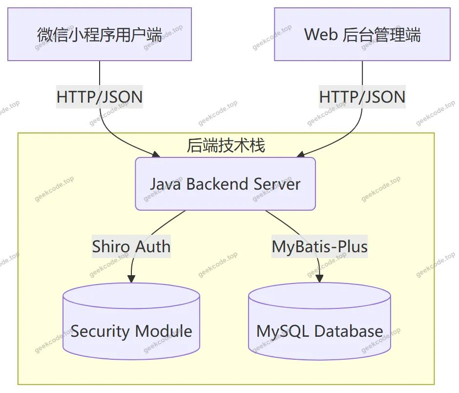</a>

<h2>功能模块</h2>

根据代码上下文中的 Controller 列表、后台路由及截图功能列表，系统主要划分为以下两个核心模块：

<h3>1. 小程序用户端（居民端）</h3>

该模块面向普通居民，提供便捷的医疗服务与生活辅助功能。

<ul>
<li><strong>账户管理</strong>：</li>
<li><strong>注册/登录</strong>：用户可通过手机号或账号密码注册成为居民（对应 <code>Jumin</code> 实体及登录/注册页面截图）。</li>
<li><strong>个人信息</strong>：查看和编辑个人基本资料。</li>
<li><strong>收货地址管理</strong>：添加、修改、删除收货地址，用于商城订单配送（对应 <code>AddressController</code> 及地址详情截图）。</li>
<li><strong>医疗服务</strong>：</li>
<li><strong>科室查询</strong>：浏览医院或社区中心提供的科室名称列表（对应 <code>Keshimingcheng</code> 相关功能）。</li>
<li><strong>预约挂号</strong>：选择科室并提交挂号申请，生成挂号信息记录（对应 <code>Guahaoxinxi</code> 及挂号信息列表截图）。</li>
<li><strong>就诊信息</strong>：查看个人的历史就诊记录或当前状态（对应“就诊信息”截图）。</li>
<li><strong>资讯与健康教育</strong>：</li>
<li><strong>新闻浏览</strong>：查看疫情相关新闻公告及分类信息（对应 <code>Xinwenxinxi</code>, <code>Xinwenfenlei</code> 及新闻列表截图）。</li>
<li><strong>评论互动</strong>：对新闻信息进行发表评论（对应 <code>Discussxinwenxinxi</code> 及评论功能截图）。</li>
<li><strong>在线客服/智能助手</strong>：通过聊天界面咨询问题，支持人工客服或预设问答机器人（对应 <code>ChatController</code>, <code>ChathelperController</code> 及在线客服截图）。</li>
<li><strong>费用与支付</strong>：</li>
<li><strong>费用查询</strong>：查看医疗费用明细及分类（对应 <code>Feiyongxinxi</code>, <code>Feiyongfenlei</code> 及费用列表截图）。</li>
<li><strong>账户充值</strong>：进行余额充值操作（对应“账户充值payconfirm”截图）。</li>
<li><strong>支付确认</strong>：在挂号或购买商品后进行支付确认（对应 <code>Payconfirm</code> 页面）。</li>
<li><strong>商城服务</strong>：</li>
<li><strong>商品浏览</strong>：查看商品信息列表及类型分类（对应 <code>Shangpinxinxi</code>, <code>Shangpinleixing</code> 及商品列表截图）。</li>
<li><strong>购物车</strong>：将感兴趣的商品加入购物车（对应 <code>CartController</code> 及购物车截图）。</li>
<li><strong>订单管理</strong>：创建订单、查看我的订单列表、跟踪物流状态（对应 <code>Orders/:status</code> 路由及订单/物流截图）。</li>
<li><strong>收藏</strong>：收藏喜欢的商品或内容（对应 <code>Storeup</code> 及我的收藏截图）。</li>
</ul>
<h3>2. Web 后台管理端（管理员端）</h3>

该模块面向系统管理员，负责基础数据维护、业务审核及系统配置。

<ul>
<li><strong>系统管理与配置</strong>：</li>
<li><strong>登录</strong>：管理员身份验证入口。</li>
<li><strong>首页仪表盘</strong>：展示系统关键数据概览。</li>
<li><strong>系统简介/关于我们</strong>：维护平台介绍文案（对应 <code>Systemintro</code>, <code>Aboutus</code> 路由及截图）。</li>
<li><strong>配置管理</strong>：系统参数设置（对应 <code>ConfigController</code> 及 <code>/config</code> 路由）。</li>
<li><strong>内容管理</strong>：</li>
<li><strong>新闻管理</strong>：发布、编辑、删除新闻信息及新闻分类（对应 <code>/news</code>, <code>/xinwenxinxi</code>, <code>/xinwenfenlei</code> 路由及截图）。</li>
<li><strong>公告管理</strong>：发布系统通知或公告（对应 <code>/aboutus</code> 关联的公告信息截图）。</li>
<li><strong>评论管理</strong>：审核和管理用户对新闻或商品的评论（对应 <code>/discussxinwenxinxi</code>, <code>/discussshangpinxinxi</code> 路由）。</li>
<li><strong>业务数据管理</strong>：</li>
<li><strong>居民管理</strong>：查看和管理注册用户信息（对应 <code>/jumin</code> 路由及管理端居民列表截图）。</li>
<li><strong>科室管理</strong>：维护科室名称数据（对应 <code>/keshimingcheng</code> 路由及管理端科室列表截图）。</li>
<li><strong>挂号管理</strong>：审核和处理用户的挂号请求（对应 <code>/guahaoxinxi</code> 路由）。</li>
<li><strong>费用管理</strong>：维护费用分类及具体费用信息（对应 <code>/feiyongxinxi</code>, <code>/feiyongfenlei</code> 路由及管理端费用分类列表截图）。</li>
<li><strong>商品管理</strong>：上架、下架商品，管理商品类型（对应 <code>/shangpinxinxi</code>, <code>/shangpinleixing</code> 路由及管理端商品类型列表截图）。</li>
<li><strong>订单管理</strong>：查看所有订单状态，处理发货或退款（对应 <code>/orders/:status</code> 路由）。</li>
<li><strong>聊天助手管理</strong>：配置智能客服问答库或查看聊天记录（对应 <code>/chathelper</code> 路由及管理端聊天助手列表截图）。</li>
</ul>
<h2>用户角色与权限</h2>

系统主要包含两类角色：<strong>居民用户</strong>（小程序端）和 <strong>系统管理员</strong>（Web 后台端）。

<h3>1. 居民用户 (Jumin)</h3>
<ul>
<li><strong>权限范围</strong>：仅限访问微信小程序前端。</li>
<li><strong>可执行操作</strong>：</li>
<li><strong>个人事务</strong>：注册、登录、修改个人信息、管理收货地址。</li>
<li><strong>医疗业务</strong>：浏览科室、提交挂号申请、查看就诊记录、查询费用明细。</li>
<li><strong>资讯互动</strong>：阅读新闻、发布公告、发表新闻评论、使用在线客服。</li>
<li><strong>消费行为</strong>：浏览商品、加入购物车、下单购买、支付订单、查看订单物流、收藏商品。</li>
<li><strong>资金操作</strong>：账户充值。</li>
<li><strong>限制</strong>：无法访问 Web 后台，无法修改系统基础数据（如科室名称、新闻分类），仅能查看与自己相关的业务数据。</li>
</ul>
<h3>2. 系统管理员 (Admin)</h3>
<ul>
<li><strong>权限范围</strong>：仅限访问 Web 后台管理端。</li>
<li><strong>可执行操作</strong>：</li>
<li><strong>全量数据管理</strong>：对所有业务实体（居民、科室、新闻、商品、费用、挂号、订单、评论、聊天助手等）拥有增、删、改、查权限。</li>
<li><strong>内容审核</strong>：管理新闻发布、审核用户评论、维护公告信息。</li>
<li><strong>系统配置</strong>：修改系统简介、关于我们的内容、全局配置参数。</li>
<li><strong>用户监管</strong>：查看居民列表，监控挂号与订单状态。</li>
<li><strong>限制</strong>：通常不直接参与前端的业务交易（如自己挂号或买东西），而是专注于数据的维护和服务的管理。</li>
</ul>
<h2>项目特色与创新点</h2>
<ol>
<li>
<strong>多端协同的服务闭环</strong>：
   项目实现了从“信息获取”（新闻、科室）到“服务预约”（挂号）再到“后续跟进”（就诊信息、费用查询）的全流程覆盖，并结合了“生活辅助”（商城、充值），形成了完整的居民健康与生活服务体系。

</li>
<li>
<strong>智能化客服集成</strong>：
   引入了 <code>Chathelper</code>（聊天助手）模块，结合 <code>Chat</code> 功能，提供了在线客服与可能的智能问答能力，提升了用户在疫情期间或非工作时间获取信息的便捷性，降低了人工客服压力。

</li>
<li>
<strong>精细化的权限与数据隔离</strong>：
   基于 Shiro 框架实现的安全机制，确保了居民只能看到自己的挂号、订单和费用数据，而管理员拥有全局视野。这种数据隔离对于涉及个人隐私（如健康信息、住址）的医疗类系统至关重要。

</li>
<li>
<strong>灵活的后台路由架构</strong>：
   后台采用了细粒度的路由设计（如 <code>/discussshangpinxinxi</code>, <code>/feiyongfenlei</code> 等独立路径），表明系统对不同类型的评论、不同维度的费用分类进行了独立的数据模型设计和接口封装，体现了良好的模块化开发思想。

</li>
<li>
<strong>疫情背景下的实用价值</strong>：
   针对“居民疫情服务”这一特定场景，系统强化了“新闻公告”、“在线问诊/咨询”和“无接触式挂号/支付”功能，有效减少了线下人员聚集，符合公共卫生应急管理的实际需求。

</li>
</ol>
<h2>部署环境</h2>

为确保系统正常运行，需准备以下软件及硬件环境：

<ol>
<li><strong>操作系统</strong>：Windows 10/11 或 Linux (CentOS/Ubuntu)。</li>
<li><strong>Java 运行环境</strong>：</li>
</ol>
<ul>
<li>JDK 版本：建议 JDK 1.8 或 JDK 11（需兼容 Spring Boot 版本）。</li>
<li>Maven：用于项目依赖管理和构建。</li>
</ul>
<ol start="3">
<li><strong>数据库</strong>：</li>
</ol>
<ul>
<li>MySQL：版本 5.7 或 8.0+。需初始化相应的表结构（居民、科室、新闻、订单等）。</li>
</ul>
<ol start="4">
<li><strong>后端服务器</strong>：</li>
</ol>
<ul>
<li>Tomcat：内置于 Spring Boot Jar 包中，无需单独安装外部 Tomcat，但需开放相应端口（默认 8080）。</li>
</ul>
<ol start="5">
<li><strong>前端开发工具</strong>：</li>
</ol>
<ul>
<li><strong>微信开发者工具</strong>：用于编写、调试和预览微信小程序代码。</li>
<li><strong>Node.js &amp; npm/yarn</strong>：如果后台 Web 前端是基于 Vue/React 构建的 SPA，则需要 Node.js 环境进行编译打包。若后台仅为静态 HTML/JSP，则不需要。鉴于项目类型为 vue-integrated，通常需要 Node.js 环境。</li>
</ul>
<ol start="6">
<li><strong>其他依赖</strong>：</li>
</ol>
<ul>
<li>网络连接：用于访问微信 API 及数据库连接。</li>
<li>域名与 SSL 证书（生产环境）：微信小程序正式运行需要 HTTPS 协议支持的域名。</li>
</ul>
<h2>五、技术特性</h2>
<ul>
<li>前后端集成部署，前端资源打包至后端 static 目录</li>
<li>使用 MyBatis-Plus 简化数据访问层开发</li>
<li>集成 Shiro 权限框架实现角色权限控制</li>
</ul>
<h2>六、功能模块截图</h2>
<h3>微信小程序用户端</h3>

<figure><a href="https://geekcode.top/archives/%E5%9F%BA%E4%BA%8E%E5%BE%AE%E4%BF%A1%E5%B0%8F%E7%A8%8B%E5%BA%8F%E7%9A%84%E5%B1%85%E6%B0%91%E7%96%AB%E6%83%85%E6%9C%8D%E5%8A%A1%E7%B3%BB%E7%BB%9F?utm_source=github" title="查看完整源码">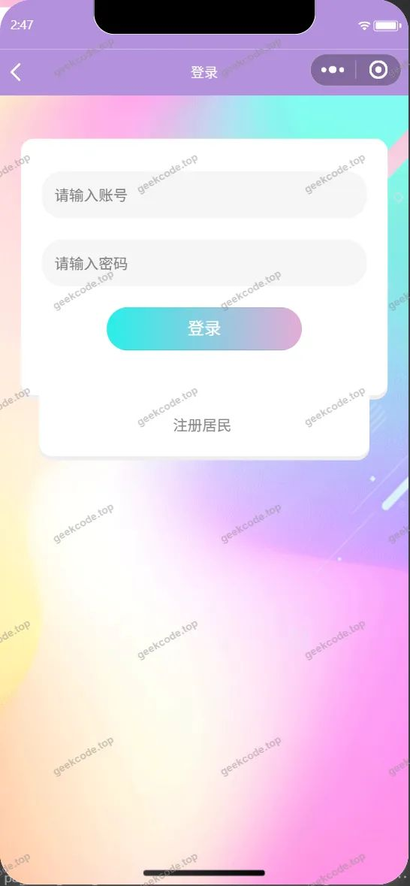</a><figcaption>小程序-登录</figcaption></figure>
<figure><a href="https://geekcode.top/archives/%E5%9F%BA%E4%BA%8E%E5%BE%AE%E4%BF%A1%E5%B0%8F%E7%A8%8B%E5%BA%8F%E7%9A%84%E5%B1%85%E6%B0%91%E7%96%AB%E6%83%85%E6%9C%8D%E5%8A%A1%E7%B3%BB%E7%BB%9F?utm_source=github" title="查看完整源码">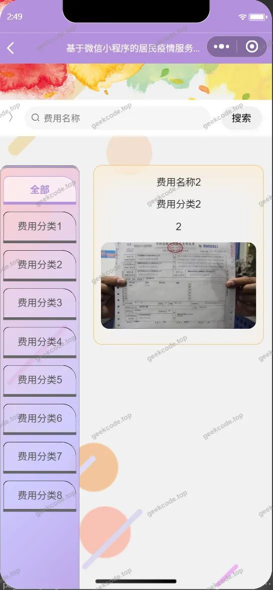</a><figcaption>小程序-费用信息列表</figcaption></figure>
<figure><a href="https://geekcode.top/archives/%E5%9F%BA%E4%BA%8E%E5%BE%AE%E4%BF%A1%E5%B0%8F%E7%A8%8B%E5%BA%8F%E7%9A%84%E5%B1%85%E6%B0%91%E7%96%AB%E6%83%85%E6%9C%8D%E5%8A%A1%E7%B3%BB%E7%BB%9F?utm_source=github" title="查看完整源码">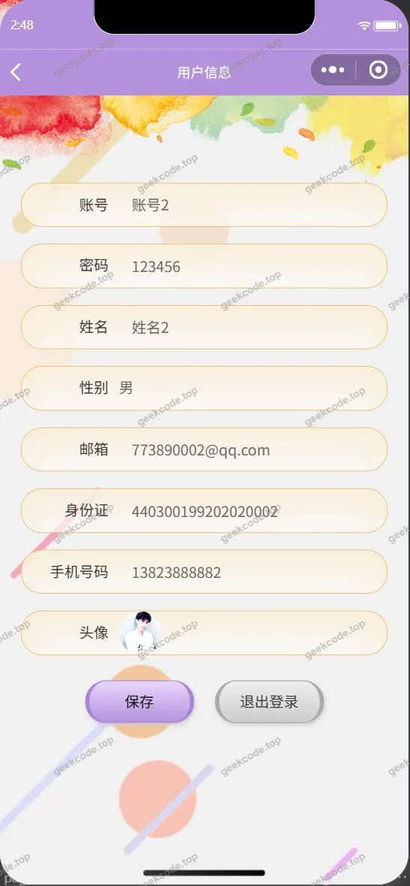</a><figcaption>小程序-个人信息</figcaption></figure>
<figure><figcaption>小程序-购物车</figcaption></figure>
<figure><figcaption>小程序-挂号信息列表</figcaption></figure>
<figure><figcaption>小程序-就诊信息</figcaption></figure>
<figure><figcaption>小程序-确认订单</figcaption></figure>
<figure><figcaption>小程序-商品信息列表</figcaption></figure>
<figure><figcaption>小程序-收货地址</figcaption></figure>
<figure><figcaption>小程序-收货地址详情</figcaption></figure>
<figure><figcaption>小程序-首页</figcaption></figure>
<figure><figcaption>小程序-我的</figcaption></figure>
<figure><figcaption>小程序-我的订单</figcaption></figure>
<figure><figcaption>小程序-我的订单logistics</figcaption></figure>
<figure><figcaption>小程序-我的收藏列表</figcaption></figure>
<figure><a href="https://geekcode.top/archives/%E5%9F%BA%E4%BA%8E%E5%BE%AE%E4%BF%A1%E5%B0%8F%E7%A8%8B%E5%BA%8F%E7%9A%84%E5%B1%85%E6%B0%91%E7%96%AB%E6%83%85%E6%9C%8D%E5%8A%A1%E7%B3%BB%E7%BB%9F?utm_source=github" title="查看完整源码">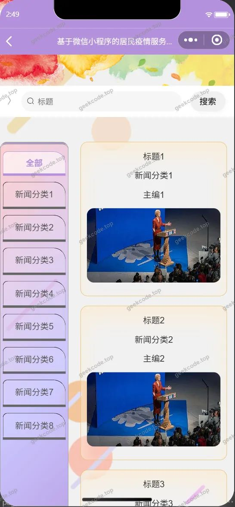</a><figcaption>小程序-新闻信息列表</figcaption></figure>
<figure><figcaption>小程序-在线客服</figcaption></figure>
<figure><figcaption>小程序-账户充值payconfirm</figcaption></figure>
<figure><figcaption>小程序-注册</figcaption></figure>
<figure><a href="https://geekcode.top/archives/%E5%9F%BA%E4%BA%8E%E5%BE%AE%E4%BF%A1%E5%B0%8F%E7%A8%8B%E5%BA%8F%E7%9A%84%E5%B1%85%E6%B0%91%E7%96%AB%E6%83%85%E6%9C%8D%E5%8A%A1%E7%B3%BB%E7%BB%9F?utm_source=github" title="查看完整源码">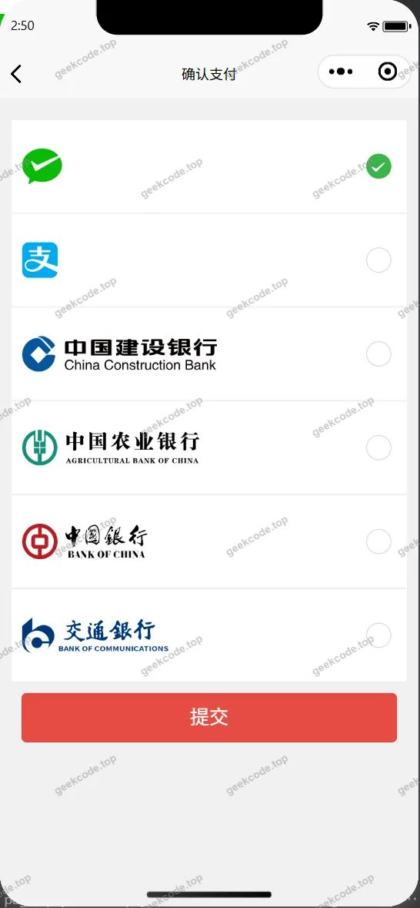</a><figcaption>小程序-payconfirm</figcaption></figure>

<h3>微信小程序管理端</h3>

<figure><figcaption>小程序-管理端-费用分类列表</figcaption></figure>
<figure><figcaption>小程序-管理端-公告信息列表</figcaption></figure>
<figure><figcaption>小程序-管理端-关于我们列表</figcaption></figure>
<figure><figcaption>小程序-管理端-居民列表</figcaption></figure>
<figure><a href="https://geekcode.top/archives/%E5%9F%BA%E4%BA%8E%E5%BE%AE%E4%BF%A1%E5%B0%8F%E7%A8%8B%E5%BA%8F%E7%9A%84%E5%B1%85%E6%B0%91%E7%96%AB%E6%83%85%E6%9C%8D%E5%8A%A1%E7%B3%BB%E7%BB%9F?utm_source=github" title="查看完整源码">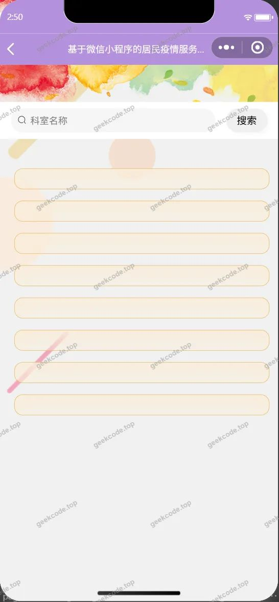</a><figcaption>小程序-管理端-科室名称列表</figcaption></figure>
<figure><a href="https://geekcode.top/archives/%E5%9F%BA%E4%BA%8E%E5%BE%AE%E4%BF%A1%E5%B0%8F%E7%A8%8B%E5%BA%8F%E7%9A%84%E5%B1%85%E6%B0%91%E7%96%AB%E6%83%85%E6%9C%8D%E5%8A%A1%E7%B3%BB%E7%BB%9F?utm_source=github" title="查看完整源码">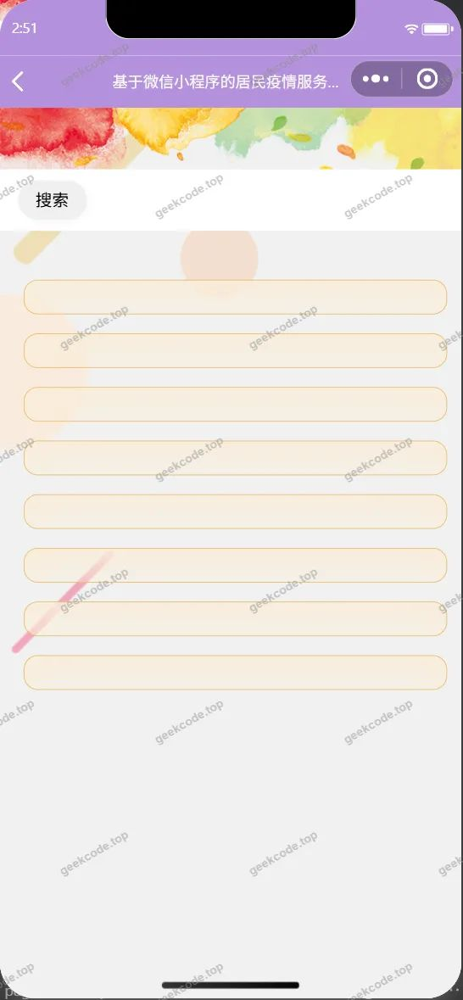</a><figcaption>小程序-管理端-聊天助手列表</figcaption></figure>
<figure><a href="https://geekcode.top/archives/%E5%9F%BA%E4%BA%8E%E5%BE%AE%E4%BF%A1%E5%B0%8F%E7%A8%8B%E5%BA%8F%E7%9A%84%E5%B1%85%E6%B0%91%E7%96%AB%E6%83%85%E6%9C%8D%E5%8A%A1%E7%B3%BB%E7%BB%9F?utm_source=github" title="查看完整源码">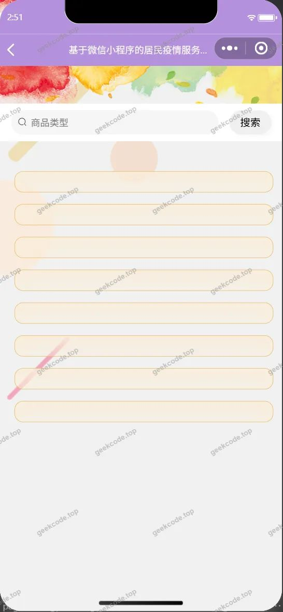</a><figcaption>小程序-管理端-商品类型列表</figcaption></figure>
<figure><figcaption>小程序-管理端-系统简介列表</figcaption></figure>
<figure><figcaption>小程序-管理端-新闻分类列表</figcaption></figure>

<h3>后台管理端</h3>
<h4>后台-登录页</h4>

<a href="https://geekcode.top/archives/%E5%9F%BA%E4%BA%8E%E5%BE%AE%E4%BF%A1%E5%B0%8F%E7%A8%8B%E5%BA%8F%E7%9A%84%E5%B1%85%E6%B0%91%E7%96%AB%E6%83%85%E6%9C%8D%E5%8A%A1%E7%B3%BB%E7%BB%9F?utm_source=github" title="查看完整源码">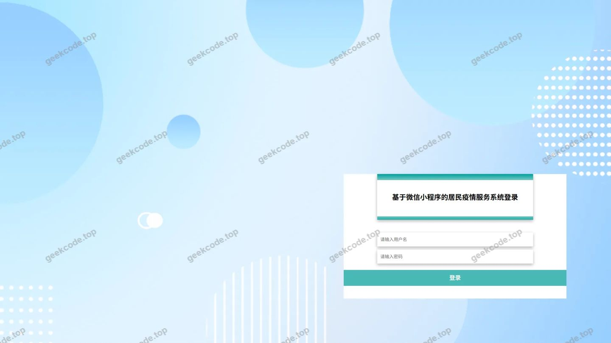</a>

<h4>后台-公告信息</h4>

<a href="https://geekcode.top/archives/%E5%9F%BA%E4%BA%8E%E5%BE%AE%E4%BF%A1%E5%B0%8F%E7%A8%8B%E5%BA%8F%E7%9A%84%E5%B1%85%E6%B0%91%E7%96%AB%E6%83%85%E6%9C%8D%E5%8A%A1%E7%B3%BB%E7%BB%9F?utm_source=github" title="查看完整源码">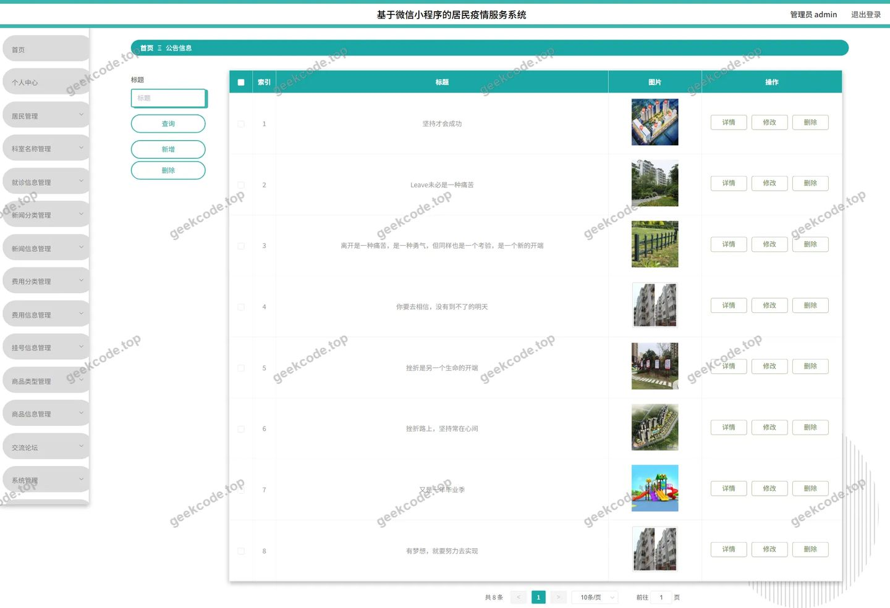</a>

<h4>后台-挂号信息</h4>

<a href="https://geekcode.top/archives/%E5%9F%BA%E4%BA%8E%E5%BE%AE%E4%BF%A1%E5%B0%8F%E7%A8%8B%E5%BA%8F%E7%9A%84%E5%B1%85%E6%B0%91%E7%96%AB%E6%83%85%E6%9C%8D%E5%8A%A1%E7%B3%BB%E7%BB%9F?utm_source=github" title="查看完整源码">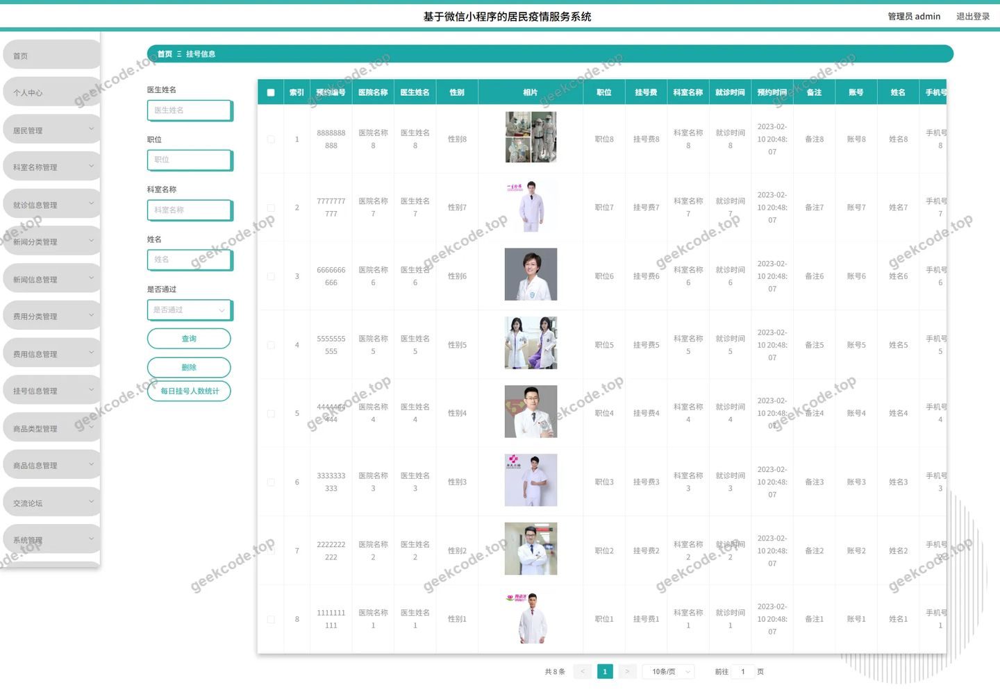</a>

<h4>后台-关于我们</h4>

<a href="https://geekcode.top/archives/%E5%9F%BA%E4%BA%8E%E5%BE%AE%E4%BF%A1%E5%B0%8F%E7%A8%8B%E5%BA%8F%E7%9A%84%E5%B1%85%E6%B0%91%E7%96%AB%E6%83%85%E6%9C%8D%E5%8A%A1%E7%B3%BB%E7%BB%9F?utm_source=github" title="查看完整源码">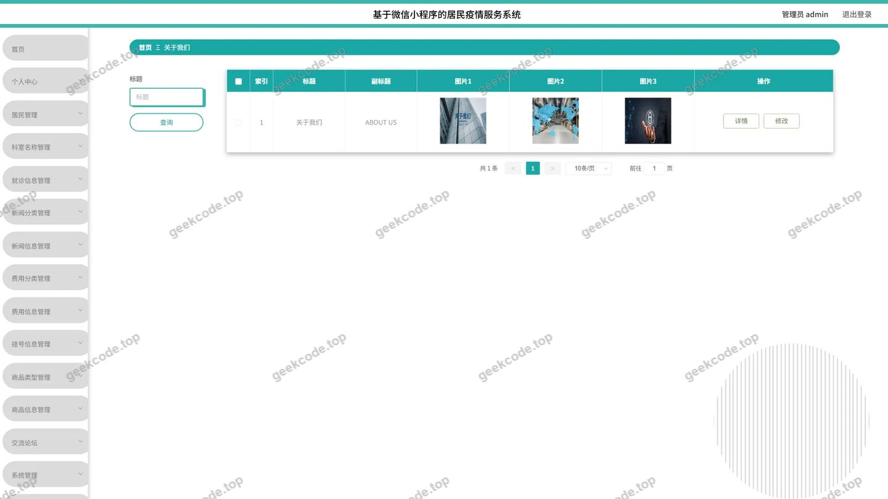</a>

<h4>后台-科室名称</h4>

<h4>后台首页</h4>

<h4>后台-新闻分类</h4>

<a href="https://geekcode.top/archives/%E5%9F%BA%E4%BA%8E%E5%BE%AE%E4%BF%A1%E5%B0%8F%E7%A8%8B%E5%BA%8F%E7%9A%84%E5%B1%85%E6%B0%91%E7%96%AB%E6%83%85%E6%9C%8D%E5%8A%A1%E7%B3%BB%E7%BB%9F?utm_source=github" title="查看完整源码">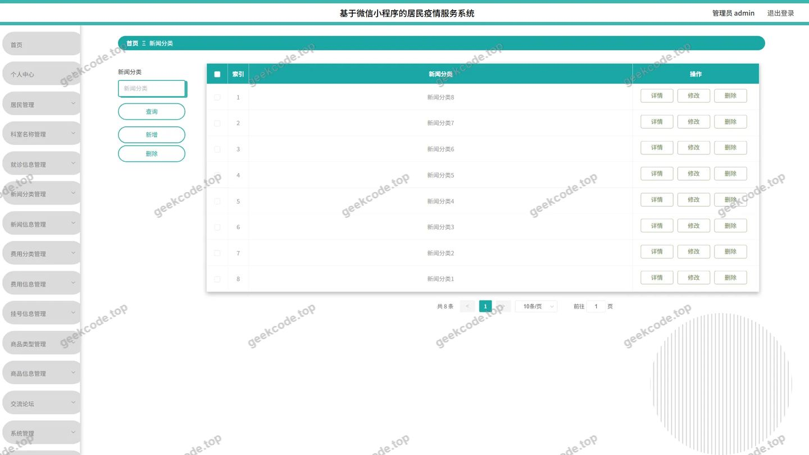</a>

<h4>后台-新闻信息评论</h4>

<a href="https://geekcode.top/archives/%E5%9F%BA%E4%BA%8E%E5%BE%AE%E4%BF%A1%E5%B0%8F%E7%A8%8B%E5%BA%8F%E7%9A%84%E5%B1%85%E6%B0%91%E7%96%AB%E6%83%85%E6%9C%8D%E5%8A%A1%E7%B3%BB%E7%BB%9F?utm_source=github" title="查看完整源码">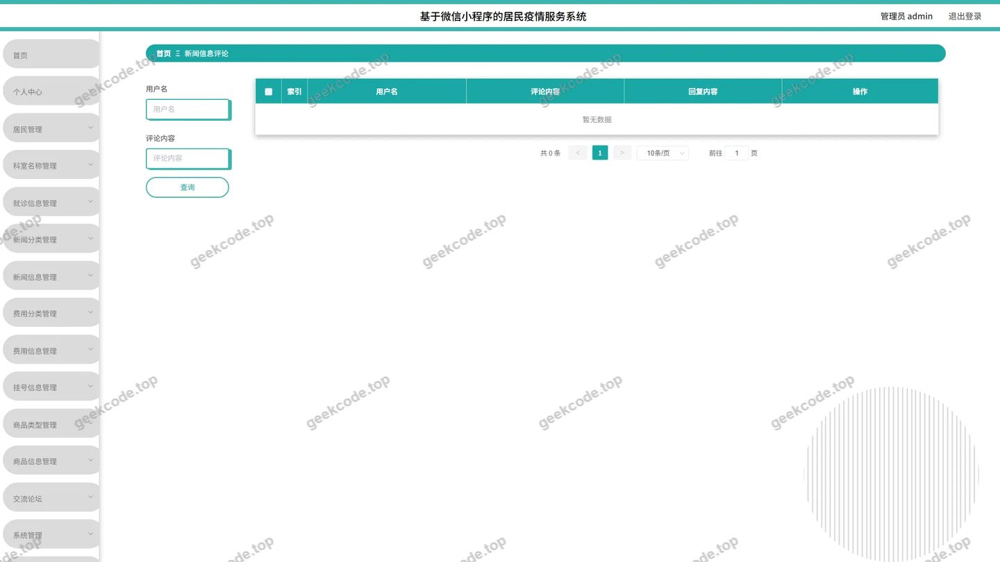</a>

---

## 获取完整源码

| 项目 | 说明 |
| --- | --- |
| 项目名 | 基于微信小程序的居民疫情服务系统 |
| 运行截图 | 本文 38 张（站点带水印原图，仓库 `images/` 目录） |
| 完整源码 | [https://geekcode.top/archives/%E5%9F%BA%E4%BA%8E%E5%BE%AE%E4%BF%A1%E5%B0%8F%E7%A8%8B%E5%BA%8F%E7%9A%84%E5%B1%85%E6%B0%91%E7%96%AB%E6%83%85%E6%9C%8D%E5%8A%A1%E7%B3%BB%E7%BB%9F?utm_source=github](https://geekcode.top/archives/%E5%9F%BA%E4%BA%8E%E5%BE%AE%E4%BF%A1%E5%B0%8F%E7%A8%8B%E5%BA%8F%E7%9A%84%E5%B1%85%E6%B0%91%E7%96%AB%E6%83%85%E6%9C%8D%E5%8A%A1%E7%B3%BB%E7%BB%9F?utm_source=github) |
| 咨询微信 | **ir9372**（备注：jingpin-yuanma） |
| 更多项目 | [极客代码 geekcode.top](https://geekcode.top/?utm_source=github) |

> 需要源码、部署、改配置、跑不起来等问题，加微信 ir9372 沟通，说明项目名即可。
